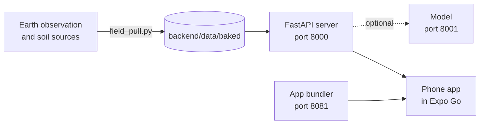
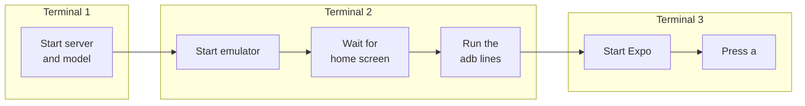
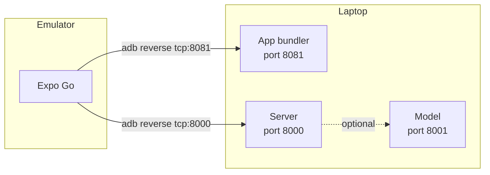
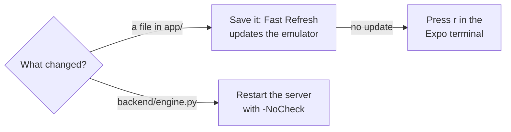
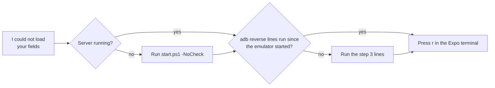
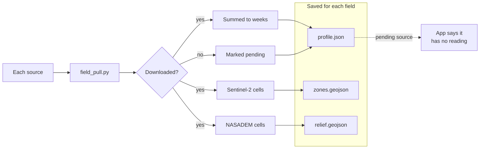
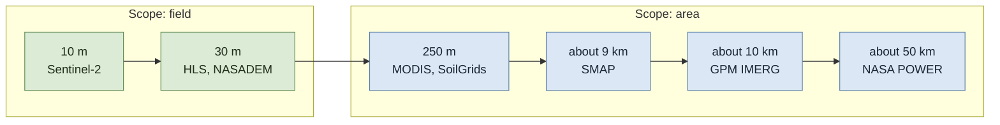

<div align="center">

# TerraCycle

**A crop-rotation assistant for farmers.**

Ask a question in plain words. Get one direct answer, based on NASA Earth observations for your own land.


[Quick start](#quick-start) · [Run each part](#run-each-part) · [Change the design](#change-the-design) · [Troubleshooting](#troubleshooting) · [Setup](#one-time-setup) · [Data](#data)

</div>

---

## Overview

| Path | What it holds |
|---|---|
| `app/` | The phone app (Expo, React Native, TypeScript) |
| `backend/` | The server (Python, FastAPI) and the data download script |
| `ai/` | The model and its setup notes (`ai/README.md`) |
| `STATUS.md` | The project status and the work plan (in Romanian) |



## Quick start

> [!NOTE]
> Everything below is for **Windows, in PowerShell**, from the project folder (`Desktop\TerraCycle`). It assumes the [one-time setup](#one-time-setup) is done.



**1. Server and model** · terminal 1

```powershell
.\start.ps1
```

**2. Emulator** · terminal 2

```powershell
& "$env:LOCALAPPDATA\Android\Sdk\emulator\emulator.exe" -avd TerraPixel -gpu swiftshader_indirect
```

**3. Connect the emulator to the laptop** · terminal 2, once the phone shows its home screen

```powershell
$adb = "$env:LOCALAPPDATA\Android\Sdk\platform-tools\adb.exe"
& $adb devices
& $adb reverse tcp:8081 tcp:8081
& $adb reverse tcp:8000 tcp:8000
```

`adb devices` must list `emulator-5554  device`. The two `reverse` lines let the emulator reach the app bundler (8081) and the server (8000) on the laptop.



> [!IMPORTANT]
> The `reverse` lines are lost every time the emulator restarts, so run them again after each restart.

**4. The app** · terminal 3

```powershell
cd app
npx expo start --go --localhost
```

Then press **`a`**.

## Run each part

### Server and model

| Command | What it does |
|---|---|
| `.\start.ps1` | Server and model, then the 25 end-to-end checks |
| `.\start.ps1 -NoCheck` | Same, without the checks (faster) |
| `.\start.ps1 -NoModel` | Server only; questions are matched on keywords |
| `.\start.ps1 -Stop` | Stop both |

It prints `Server: up on port 8000` and, after about half a minute, `Model: up on port 8001`. Both run in the background; the terminal can be closed.

Logs, if something does not start: `backend\cache\server.err` and `ai\runs\serve.err`.

To see the test farm with parcels in four countries instead of the demo farm:

```powershell
$env:TERRACYCLE_FIELDS = 'fields_world.json'
.\start.ps1 -NoCheck
```

Close that terminal (or run `Remove-Item Env:TERRACYCLE_FIELDS`) to go back to the demo farm.

### Emulator

```powershell
& "$env:LOCALAPPDATA\Android\Sdk\emulator\emulator.exe" -avd TerraPixel -gpu swiftshader_indirect
```

- A phone window opens. The first start takes one to two minutes; wait for the home screen.
- `-gpu swiftshader_indirect` draws on the processor. Without it the window stays white on this laptop.
- Leave this terminal open: closing it closes the emulator.
- To stop the emulator: close its window, or `& $adb emu kill`.

### App

```powershell
cd app
npx expo start --go --localhost
```

Wait for the QR code and the line `Metro waiting on ...`, then press **`a`** in this terminal. The app opens in Expo Go inside the emulator. The first load takes up to a minute.

| Key | What it does |
|:---:|---|
| `a` | Open the app on the emulator |
| `r` | Reload the app |
| `m` | Open the developer menu on the emulator |
| `j` | Open the debugger in the browser |
| `Ctrl+C` | Stop |

## Change the design

Save a file and the emulator updates within a second or two (Fast Refresh); the app keeps its place. If it does not update, press `r` in the Expo terminal.

| What | Where |
|---|---|
| Colours, fonts, spacing, text sizes | `app/src/theme.ts` |
| Every text on screen | `app/src/i18n.tsx` |
| Ask (home) screen | `app/src/app/(tabs)/index.tsx` |
| My land (map) screen | `app/src/app/(tabs)/land.tsx` |
| Data screen | `app/src/app/(tabs)/data.tsx` |
| History screen | `app/src/app/history.tsx` |
| Tab bar and app frame | `app/src/app/(tabs)/_layout.tsx`, `app/src/app/_layout.tsx` |
| Buttons, cards, loading and error states | `app/src/components/ui.tsx` |
| Answer cards (rotation plan, chart, limits) | `app/src/components/cards.tsx` |
| Charts | `app/src/components/charts.tsx` |
| The satellite map, field outlines, weak squares | `app/src/components/LeafletMap.tsx` |
| Small field shapes in lists | `app/src/components/FieldShape.tsx` |
| Icons | `app/src/components/Icon.tsx` |
| App name, icon, splash colour | `app/app.json`, `app/assets/` |

The answers themselves (their sentences, cards and tap replies) come from the server, in `backend/engine.py`. A change there needs a server restart: `.\start.ps1 -NoCheck`.



After design changes, check that nothing broke:

```powershell
cd app
npx tsc --noEmit
npx expo lint
```

> [!TIP]
> **Design without the server:** empty the value in `app\.env` (`EXPO_PUBLIC_API_URL=`) and restart Expo. The app then uses the sample data in `app/src/mock/`, which is out of date (old fields, the old rotation). Good enough for layout work, not for checking answers.

## Troubleshooting

`$adb` is the variable set in [step 3 of the quick start](#quick-start).

| What you see | What to do |
|---|---|
| Emulator window is white | Start it with `-gpu swiftshader_indirect`. |
| Emulator window is partly off the screen | Close the emulator. In `%USERPROFILE%\.android\avd\TerraPixel.avd\emulator-user.ini` set `window.x = 40` and `window.y = 40`, then start it again. |
| "System UI isn't responding" | Tap "Wait". If it comes back: `& $adb root`, then `& $adb shell pkill -f com.android.systemui`. |
| `adb devices` lists nothing | Wait until the emulator shows its home screen, then try again. |
| App shows "I could not load your fields" | The server is not running, or the `reverse` lines were not run after the emulator started. Run `.\start.ps1 -NoCheck` and the step 3 lines, then press `r`. |
| Expo says port 8081 is in use | An old Expo is still running. Close its terminal, or answer `y` to use another port (then reverse that port instead of 8081). |
| Pressing `a` does nothing / "Expo Go not installed" | Open Expo Go on the emulator yourself and type `exp://127.0.0.1:8081`, or reinstall it with `a` and accept the prompt. |
| Red error screen in the app | Read the first line: it names the file and line. Fix and save; the screen clears by itself. |
| Answers are slow or only ask "Which field?" | The model is off: `.\start.ps1` shows whether it started. The app still works on keywords. |
| `npm install` fails on dependencies | `npm install --legacy-peer-deps` |

When the app says it could not load your fields:



## One-time setup

Already done on the team laptop.

<details>
<summary><strong>Set up a new machine</strong></summary>
<br>

1. **Node.js 22.13 or newer** (`node --version`). With winget: `winget install OpenJS.NodeJS`.
2. **Android Studio**, with the Android SDK, platform-tools and the emulator. Create a phone (Device Manager) named `TerraPixel`, or replace `TerraPixel` above with your phone's name (`& "$env:LOCALAPPDATA\Android\Sdk\emulator\emulator.exe" -list-avds`).
3. **Expo Go** on the emulator: pressing `a` the first time installs it.
4. **The app's packages:** `cd app`, then `npm install --legacy-peer-deps`. Copy `app\.env.example` to `app\.env`.
5. **The server:**

   ```powershell
   cd backend
   python -m venv .venv
   .venv\Scripts\pip install -r requirements.txt
   ```

6. **The model** (optional): see `ai/README.md`. It needs an NVIDIA graphics card and the trained adapter in `ai\runs\terracycle-lora`.

</details>

<details>
<summary><strong>Use a real phone over USB (Android)</strong></summary>
<br>

Turn on USB debugging on the phone (Settings → About phone → tap "Build number" 7 times → Developer options → USB debugging), install Expo Go from the Play Store, plug the phone in and accept the prompt.

Then follow the quick start without step 2: `adb devices` lists the phone, and the `reverse` lines work the same way.

</details>

<details>
<summary><strong>Use a real phone over Wi-Fi (Android or iPhone)</strong></summary>
<br>

Phone and laptop must be on the same network.

1. Put the laptop's address in `app\.env`: `EXPO_PUBLIC_API_URL=http://<address from ipconfig>:8000`
2. Open ports 8000 and 8081 in the Windows firewall.
3. Run `npx expo start --go` (without `--localhost`).
4. Scan the QR code with Expo Go.

</details>

## Data

Every source is downloaded once per field by `backend/field_pull.py`, summed to weeks, and saved in `backend/data/baked/<field id>/`:

| File | Contents |
|---|---|
| `profile.json` | Weekly series per year for each source, soil and relief numbers, and the status of each source |
| `zones.geojson` | Sentinel-2 10 m cells, each compared with the rest of the field |
| `relief.geojson` | NASADEM 30 m cells with slope and height |



```powershell
cd backend
.venv\Scripts\earthengine authenticate --auth_mode=localhost   # once, for the Earth Engine sources
.venv\Scripts\python field_pull.py                              # everything
.venv\Scripts\python field_pull.py --only power,soil            # only the sources that need no account
```

Earth Engine sources run under the Google Cloud project `terracycle-514620`. A source that could not be downloaded is marked `pending` in `profile.json`, and the app then says it has no reading rather than guessing.

### Sources in use

Scope says what a number describes: the field itself, or the wider area around it. The app shows this label next to every number. From the finest grid to the coarsest:



#### Scope: field

| Source | Version or collection | What we take | Period | Grid | Access |
|---|---|---|---|---|---|
| [NASADEM](https://developers.google.com/earth-engine/datasets/catalog/NASA_NASADEM_HGT_001) | `NASA/NASADEM_HGT/001` (SRTM reprocessed by NASA) | `elevation`, and slope computed from it | February 2000 | 30 m | Earth Engine |
| [Harmonized Landsat Sentinel-2 (HLS)](https://developers.google.com/earth-engine/datasets/catalog/NASA_HLS_HLSL30_v002) | `NASA/HLS/HLSL30/v002` and [`NASA/HLS/HLSS30/v002`](https://developers.google.com/earth-engine/datasets/catalog/NASA_HLS_HLSS30_v002) (version 2.0) | NDVI from red and near-infrared, clouds removed with `Fmask` | 2013–today | 30 m | Earth Engine |
| [Copernicus Sentinel-2](https://developers.google.com/earth-engine/datasets/catalog/COPERNICUS_S2_SR_HARMONIZED) (ESA) | `COPERNICUS/S2_SR_HARMONIZED` (Level-2A surface reflectance) | NDVI from `B8` and `B4`, clouds removed with `SCL` | 2017–today | 10 m | Earth Engine |

#### Scope: area

| Source | Version or collection | What we take | Period | Grid | Access |
|---|---|---|---|---|---|
| [NASA POWER](https://power.larc.nasa.gov/) | Daily API v2, AG community ([docs](https://power.larc.nasa.gov/docs/services/api/temporal/daily/)) | `T2M_MAX`, `T2M_MIN`, `T2MDEW`, `WS2M`, `ALLSKY_SFC_SW_DWN`, `PRECTOTCORR`, `GWETROOT` | 2001–2020 for the baseline; to today for the live server | about 50 km | API, no account |
| [MODIS Terra Vegetation Indices](https://developers.google.com/earth-engine/datasets/catalog/MODIS_061_MOD13Q1) | `MODIS/061/MOD13Q1` (Collection 6.1) | `NDVI` × 0.0001, kept where `SummaryQA` is 0 or 1 | 2001–2020 | 250 m, 16 days | Earth Engine |
| [SMAP L4 Global Soil Moisture](https://developers.google.com/earth-engine/datasets/catalog/NASA_SMAP_SPL4SMGP_008) | `NASA/SMAP/SPL4SMGP/008` (version 8) | `sm_rootzone` | 2015–2020 | about 9 km, 3 hours | Earth Engine |
| [GPM IMERG](https://developers.google.com/earth-engine/datasets/catalog/NASA_GPM_L3_IMERG_V07) | `NASA/GPM_L3/IMERG_V07` (version 07) | `precipitation`, summed to days, for heavy-rain days | 2001–2020 | about 10 km, 30 minutes | Earth Engine |
| [ISRIC SoilGrids](https://www.isric.org/explore/soilgrids) | 2.0 ([API](https://rest.isric.org/soilgrids/v2.0/docs)) | sand, silt, clay, pH, organic carbon, 0–30 cm | static | 250 m | API, no account |

### Why these sources

- **MODIS** is used only for the 20-year history of the area: one MODIS square is 6.25 ha and none fits inside our fields.
- **Sentinel-2** is used for the map inside the field.
- **HLS** is NASA's own reading of the field.

**Optional, not downloaded yet:** [FAO GAEZ v4](https://gaez.fao.org/), to drop crops that do not suit the area.

**Not used:** ECOSTRESS (passes too rare), GEDI (measures forests), ERA5 and NLDAS/GLDAS (POWER already covers weather), and the sources that cover only the United States (USDA, SSURGO, CDL, PRISM, NAIP, NLCD, OpenET and the rest).

### Limits

> [!WARNING]
> The thresholds in `field_pull.py` (heavy rain 20 mm, bare soil NDVI 0.25, steep 5°, weaker cell 10%) are our own choices and have not been checked by an agronomist.

- POWER, SMAP, IMERG and SoilGrids are model estimates or coarse grids. They describe the area, not one field.
- Satellites show how green a field is. They do not show why. The app never names a cause as a fact.
- Field outlines are real. Field names, crops and crop history are sample values.
